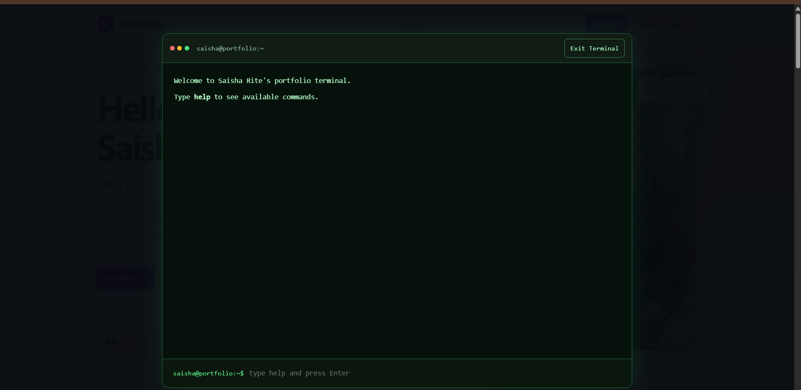
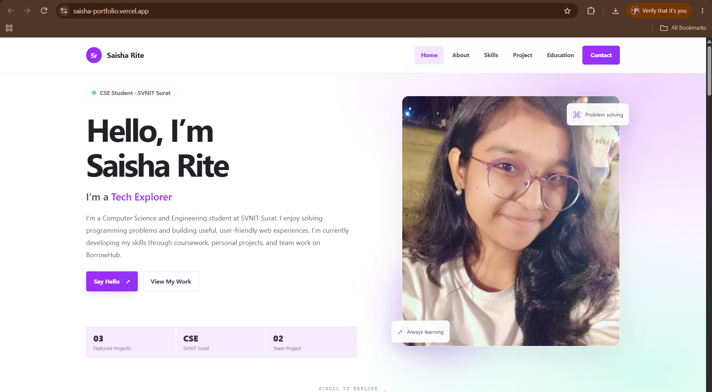
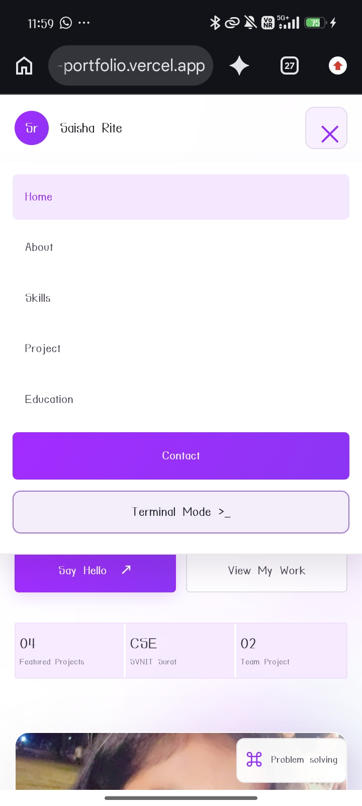

# Saisha Rite — Personal Portfolio

A responsive personal portfolio built using HTML, CSS, and vanilla JavaScript. It showcases my background, technical skills, projects, education, resume, and contact information.

The portfolio also includes an interactive **Terminal Mode**, where visitors can type commands to explore my profile.

## Live Website

[Visit My Portfolio](https://saisha-portfolio.vercel.app)

## Features

- Responsive design for desktop, tablet, and mobile.
- About, Skills, Projects, Education, Resume, and Contact sections.
- Animated role text and scroll-reveal effects.
- Mobile navigation menu.
- Interactive Terminal Mode with `help`, `about`, `skills`, `projects`, `contact`, `clear`, and `exit` commands.
- Contact form connected to Formspree.
- Downloadable resume.

## Projects

### 1. Personal Portfolio Website
A responsive portfolio website showcasing my skills, education, projects, and contact information.

- Technologies: HTML, CSS, JavaScript
- [GitHub Repository](https://github.com/SaishaRite/WD_1_PersonalPortfolio_byte)

### 2. BorrowHub
A campus resource-sharing platform concept where students can list, discover, lend, and borrow items.

- Status: In development
- Technologies: HTML, CSS, JavaScript, Database
- [GitHub Profile](https://github.com/SaishaRite)

### 3. NexaFlow — Responsive Landing Page
A responsive, matrix-inspired landing page with parallax scrolling and interactive UI elements.

- Technologies: HTML, CSS, JavaScript
- [GitHub Repository](https://github.com/SaishaRite/WD_2_ResponsiveLandingPage_byte)
- [Live Demo](https://nexaflow-saisharite.vercel.app)

### 4. Pip’s Dream World — HAX.Baby
A collaborative interactive website centered around Pip, a friendly dream-world character, developed as part of a 48-hour HAX.Baby hackathon.

- Technologies: HTML, CSS, JavaScript
- [Live Demo](https://haxbaby-olive.vercel.app)

## Screenshots

### Desktop View


### Projects Section


### Mobile View


## Run Locally

1. Clone or download this repository.
2. Open the project folder in VS Code.
3. Run `index.html` using Live Server.
4. Keep the CSS, JavaScript, portrait, and resume files in the same project folder.

## Project Structure

```text
WD_1_PersonalPortfolio_byte/
├── index.html
├── style.css
├── script.js
├── saisha_pic.jpeg
├── resume_saisha.pdf
├── README.md
├── .gitignore
├── portfolio-desktop.png
├── portfolio-projects.png
└── portfolio-mobile.png
```

## Contact

- Email: saisamrat2020@gmail.com
- GitHub: [SaishaRite](https://github.com/SaishaRite)
- LinkedIn: [Saisha Rite](https://www.linkedin.com/in/saisha-rite-6aba95383)

## Deployment

This is a static website deployed using Vercel. No build command is required.
